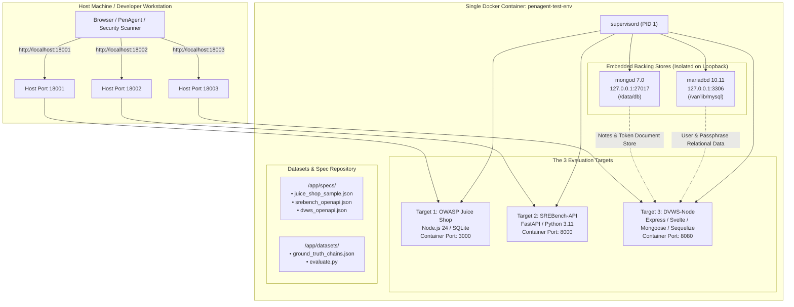

# penagent-test-env: Unified Multi-Target Benchmark Image

**Image Name:** `monisha117/penagent-test-env:latest`  
**Base Operating System:** Debian 12 (Bookworm) via `python:3.11-slim-bookworm`  
**Runtimes Included:** Node.js v24 (LTS), Python 3.11, MariaDB 10.11+, MongoDB 7.0 Community  
**Process Supervisor:** `supervisord` (v4.2.5)  
**Primary Purpose:** A self-contained, single-container evaluation environment containing all three security benchmarks (**OWASP Juice Shop**, **SREBench-API**, and **DVWS-Node**) for autonomous penetration testing agents and collaborative research teams.

---

## 1. Architectural Overview & Process Tree

Unlike typical multi-container stacks that require complex Docker Compose networks, `penagent-test-env` packages all targets, internal databases, datasets, and specifications into **one single image**. 



### Key Technical Characteristics
* **Runtime ABI Parity:** Built using multi-stage `node:24-bookworm` to guarantee that native C++ addons (`libxmljs2`, `bcrypt`) compile against `NODE_MODULE_VERSION 137`, matching the Node v24 runtime.
* **Hermetic Databases:** MariaDB and MongoDB listen exclusively on `127.0.0.1` inside the container. They never expose ports to the host, eliminating port clashes on ports 3306 or 27017.
* **Pre-Initialized Schemas:** Database tables and users (`admin` / `letmein`, `test` / `test`) are pre-seeded automatically during container startup.

---

## 2. Docker Hub Guide: Pulling, Tagging & Pushing

### 2.1 Authenticating to Docker Hub
```bash
docker login
```

### 2.2 Pulling the Image (For Collaborators & Users)
Any team member or third-party researcher only needs to pull this single image:

```bash
docker pull monisha117/penagent-test-env:latest
```

### 2.3 Tagging Local Image for Docker Hub
After building the image locally, tag it with your Docker Hub repository:

```bash
# Tag as 'latest'
docker tag penagent-test-env:latest monisha117/penagent-test-env:latest

# (Optional) Tag with a specific release version
docker tag penagent-test-env:latest monisha117/penagent-test-env:v1.0.0
```

### 2.4 Pushing the Image to Docker Hub
```bash
docker push monisha117/penagent-test-env:latest
docker push monisha117/penagent-test-env:v1.0.0
```

---

## 3. Running the Test Environment

### 3.1 Single-Command Launch (`docker run`)
Run the container using the conflict-free, contiguous port block (`18001`, `18002`, `18003`):

```bash
docker rm -f penagent-testbed 2>/dev/null || true

docker run -d \
  --name penagent-testbed \
  -p 18001:3000 \
  -p 18002:8000 \
  -p 18003:8080 \
  -v $(pwd)/reports:/app/reports \
  --restart unless-stopped \
  monisha117/penagent-test-env:latest
```

### 3.2 Optional Docker Compose Launch
If using Docker Compose, use [`docker-compose.test-env.yml`](file:///d:/GenAI/docker-compose.test-env.yml):

```yaml
services:
  penagent-testbed:
    image: monisha117/penagent-test-env:latest
    container_name: penagent-testbed
    ports:
      - "18001:3000"   # OWASP Juice Shop
      - "18002:8000"   # SREBench-API (20 Scenarios)
      - "18003:8080"   # DVWS-Node (OWASP API Top 10)
    volumes:
      - ./reports:/app/reports
      - ./specs:/app/specs
    restart: unless-stopped
```

Launch with:
```bash
docker compose -f docker-compose.test-env.yml up -d
```

---

## 4. Benchmark Catalog & Target Endpoints

Allow **~10–15 seconds** after container creation for database seeding to complete.

| Target Benchmark | Host URL | Tech Stack | Role in Evaluation | Default Credentials / Features |
| :--- | :--- | :--- | :--- | :--- |
| **Target 1: OWASP Juice Shop** | `http://localhost:18001` | Node.js 24 / SQLite | Modern e-commerce web application with 80+ vulnerabilities. | Scoreboard at `/#/score-board`. User registration open via UI. |
| **Target 2: SREBench-API** | `http://localhost:18002` | FastAPI / Python 3.11 | Novel 20-scenario cross-service microservice benchmark. | Health: `/health`<br/>Docs: `/docs`<br/>Scenarios: `/scenarios/list` |
| **Target 3: DVWS-Node** | `http://localhost:18003` | Express / Svelte / MariaDB / MongoDB | Vulnerable web service covering OWASP API Security Top 10. | UI: `http://localhost:18003`<br/>Swagger: `/api-docs`<br/>OpenAPI Spec: `/openAPI-spec.json`<br/>`admin` / `letmein`<br/>`test` / `test` |

---

## 5. Verification & Health Monitoring

### 5.1 Quick Health Check Probes
```bash
# 1. OWASP Juice Shop
curl -I http://localhost:18001

# 2. SREBench-API
curl -s http://localhost:18002/health

# 3. DVWS-Node
curl -I http://localhost:18003
```
All targets will return `HTTP/1.1 200 OK` (or JSON health status).

### 5.2 Checking Internal Service Status
To inspect the supervisor process table inside the container:
```bash
docker exec penagent-testbed supervisorctl status
```
Expected output:
```text
dvws-node        RUNNING   pid 14, uptime 0:02:15
juice-shop       RUNNING   pid 12, uptime 0:02:15
mariadb          RUNNING   pid 10, uptime 0:02:15
mongodb          RUNNING   pid 11, uptime 0:02:15
srebench         RUNNING   pid 13, uptime 0:02:15
```

### 5.3 Viewing Process Logs
```bash
docker exec penagent-testbed tail -n 25 /var/log/dvws-node.stdout.log
docker exec penagent-testbed tail -n 25 /var/log/juice-shop.stdout.log
docker exec penagent-testbed tail -n 25 /var/log/srebench.stdout.log
```

---

## 6. Integrating with PenAgent or External Security Scanners

Because all three benchmark targets expose standard host ports, any agent or security tool can interact with them directly:

### 6.1 Running PenAgent Against the Testbed
If running PenAgent from the host or another container:

```bash
# Audit SREBench-API 20 scenarios
python -m penagent.cli audit \
  --spec specs/srebench_openapi.json \
  --target http://localhost:18002 \
  --output reports/srebench_audit.json

# Audit DVWS-Node OWASP API Top 10
python -m penagent.cli audit \
  --spec specs/dvws_openapi.json \
  --target http://localhost:18003 \
  --output reports/dvws_audit.json
```

### 6.2 Evaluating Results Against Ground Truth
Run the included evaluation harness inside the container:
```bash
docker exec -it penagent-testbed python /app/datasets/evaluate.py \
  --findings /app/reports/srebench_audit.json \
  --ground-truth /app/datasets/ground_truth_chains.json
```
